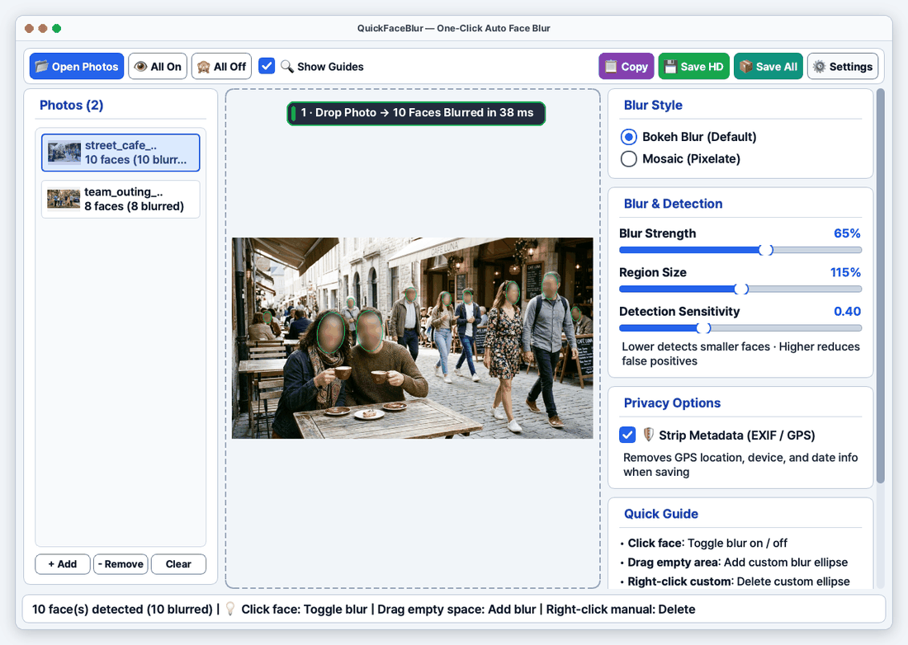
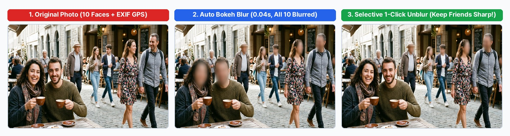
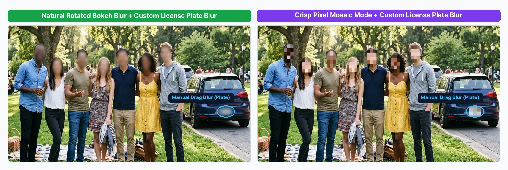
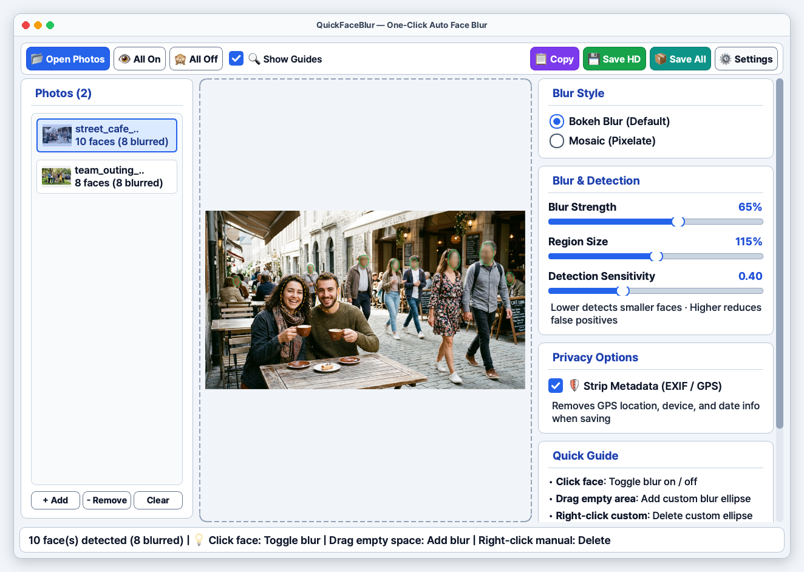
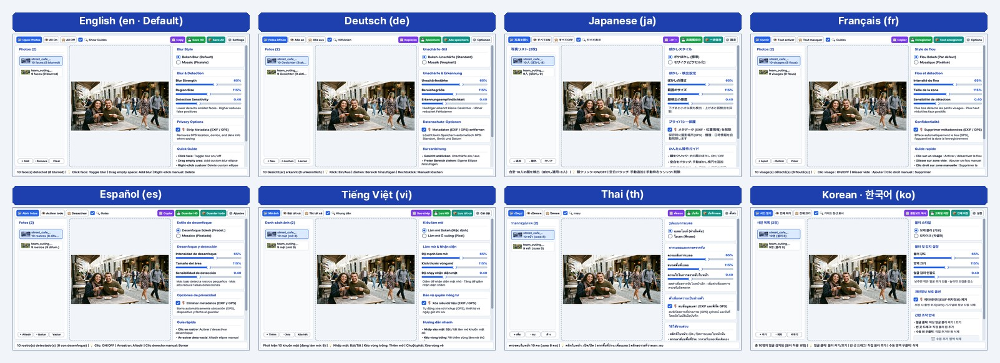

<div align="center">


# QuickFaceBlur

### Blur every face in a group photo in 0.04s — 100% offline, zero cloud uploads.

**Eye-aligned rotated bokeh & pixel mosaic · 1-click selective unblur · Batch folder export · Automatic EXIF/GPS stripping**

[](https://github.com/plan-teddy/QuickFaceBlur/releases/latest)
[](https://github.com/plan-teddy/QuickFaceBlur/actions/workflows/build-windows.yml)
[](https://github.com/plan-teddy/QuickFaceBlur/actions/workflows/build-macos.yml)
[](#why-quickfaceblur)
[](#8-language-global-localization)
[](LICENSE)

<br />

<!-- Direct 1-Click Download Buttons -->
<a href="https://github.com/plan-teddy/QuickFaceBlur/releases/download/v1.0.0/QuickFaceBlur_macOS_arm64_v1.0.0.dmg">
  
</a>
&nbsp;
<a href="https://github.com/plan-teddy/QuickFaceBlur/releases/download/v1.0.0/QuickFaceBlur_Setup_v1.0.0.exe">
  
</a>
&nbsp;
<a href="https://github.com/plan-teddy/QuickFaceBlur/releases/download/v1.0.0/QuickFaceBlur_Win11_Portable_v1.0.0.zip">
  
</a>

<p>
  <a href="https://github.com/plan-teddy/QuickFaceBlur/releases/latest"><b>All Releases & SHA-256 Checksums</b></a>
  ·
  <a href="#real-world-examples"><b>Visual Examples</b></a>
  ·
  <a href="#how-it-works-under-the-hood"><b>Architecture</b></a>
  ·
  <a href="#한국어-소개-및-사용-가이드-korean"><b>한국어 가이드</b></a>
</p>



</div>

---

## Why QuickFaceBlur?

Sharing travel photos, street snapshots, classroom events, or family gatherings shouldn't mean **uploading private photos to sketchy cloud websites** or spending 10 minutes painting ugly square blocks over every passerby.

| Capability | Web "Free Face Blur" Sites | Manual Editors / Built-in Photos | **QuickFaceBlur** |
| :--- | :---: | :---: | :---: |
| **Photo Privacy** | Uploads photos to remote servers | Local | **100% Offline Local CPU AI (Zero Telemetry)** |
| **Small & Tilted Faces** | Often misses background faces | Manual brushing required | **`SCRFD-2.5GF` 5-Point Landmark Detection (~38 ms)** |
| **Blur Aesthetics** | Harsh boxes or watermarks | Unaligned circles / blocks | **Eye-Angle Rotated Feather Bokeh & Crisp Mosaic** |
| **Keep Friends Unblurred** | Tedious | Erase mask manually | **1 Left-Click on Any Face to Toggle ON / OFF** |
| **License Plates & Badges** | Rarely supported | Separate tool | **Drag Empty Space to Add Custom Blur Ellipse** |
| **Batch Processing** | Paywalled / rate-limited | One photo at a time | **Drop 50+ Photos or Folders → Batch Export** |
| **EXIF & GPS Stripping** | Unpredictable | Usually preserved by default | **Strips GPS Coordinates & Camera EXIF Automatically** |

---

## Real-World Examples

### 1. Travel & Street Snapshots — Keep Friends Sharp, Blur Strangers in 2 Clicks

Drop a crowded street or cafe photo and **all 10 faces are blurred automatically in ~38 ms**. Click the two friends at your table to keep them sharp while every background pedestrian stays smoothly blurred.

<p align="center">
  
</p>

### 2. Group Outings & Vehicles — Feather Bokeh vs. Pixel Mosaic + License Plate Blur

Choose between **Bokeh Blur** (natural DSLR-like lens blur aligned to head tilt) and **Mosaic** (classic pixelation). Need to hide a car license plate, name tag, or document? Simply **drag on any empty area** to add a custom blur ellipse.

<p align="center">
  
</p>

### 3. Clean, High-Contrast Desktop Workspace

Designed for zero learning curve—from power users processing event batches with `Cmd+C` / `Ctrl+C` clipboard workflows to non-technical family members who want large, legible controls.

<p align="center">
  
</p>

### 4. 8-Language Global Localization

QuickFaceBlur automatically detects your OS display language on first launch (defaulting to **English**) and lets you switch languages live in **Settings (`⚙️`)** with zero restart required:

- **English (`en`)** · **Deutsch (`de`)** · **日本語 (`ja`)** · **Français (`fr`)** · **Español (`es`)** · **Tiếng Việt (`vi`)** · **ไทย (`th`)** · **한국어 (`ko`)**

<p align="center">
  
</p>

---

## 1-Click Download (No Python Required)

Grab the standalone package for your OS directly below or from the **[Releases Tab](https://github.com/plan-teddy/QuickFaceBlur/releases/latest)**:

| Operating System | Direct Download Link | Format & Size | How to Run |
| :--- | :--- | :--- | :--- |
| **macOS** *(Apple Silicon M1–M4)* | **[📥 QuickFaceBlur_macOS_arm64_v1.0.0.dmg](https://github.com/plan-teddy/QuickFaceBlur/releases/download/v1.0.0/QuickFaceBlur_macOS_arm64_v1.0.0.dmg)** | `.dmg` (~128 MB) | Open `.dmg` → Drag `QuickFaceBlur.app` to `Applications` |
| **Windows 10 / 11** *(Installer)* | **[📥 QuickFaceBlur_Setup_v1.0.0.exe](https://github.com/plan-teddy/QuickFaceBlur/releases/download/v1.0.0/QuickFaceBlur_Setup_v1.0.0.exe)** | `.exe` (~111 MB) | Run setup wizard (creates Desktop & Start Menu shortcuts) |
| **Windows 10 / 11** *(Portable)* | **[📥 QuickFaceBlur_Win11_Portable_v1.0.0.zip](https://github.com/plan-teddy/QuickFaceBlur/releases/download/v1.0.0/QuickFaceBlur_Win11_Portable_v1.0.0.zip)** | `.zip` (~128 MB) | Unzip anywhere → Run `QuickFaceBlur.exe` (no installation) |

<details>
<summary><b>💡 First-Launch Gatekeeper / SmartScreen Tip (Open-Source Unsigned Builds)</b></summary>

Because QuickFaceBlur is distributed as a free community project without paid Apple Developer ID / EV code-signing certificates:
- **macOS:** If macOS shows an unverified developer prompt on first launch, go to **System Settings → Privacy & Security → Open Anyway**, or run:
  ```bash
  xattr -cr /Applications/QuickFaceBlur.app
  ```
- **Windows:** If Windows SmartScreen appears, click **More info → Run anyway**.

</details>

---

## Quick Controls Cheat Sheet

| Action | Gesture / Shortcut |
| :--- | :--- |
| **Load photos or folders** | Drag & drop into the window (or onto the macOS Dock icon) or click **`📂 Open Photos`** |
| **Toggle blur on a single face** | **Left-click** inside any green/amber face ellipse |
| **Add a custom blur region** | **Left-drag** (or right-drag) across any empty area (license plates, badges, etc.) |
| **Delete a custom blur region** | **Right-click** inside the blue manual ellipse (or click **`🗑️ Clear Manual Regions`**) |
| **Copy full-HD result to clipboard** | **`Cmd + C`** (macOS) / **`Ctrl + C`** (Windows) or click **`📋 Copy`** |
| **Preview clean output** | Uncheck **`🔍 Show Guides`** on the top bar |

---

## How It Works Under the Hood

1. **Single-Pass Cached ONNX Detection (`SCRFD-2.5GF`):**
   Each photo is letterbox-normalized to `640×640` and evaluated once via `onnxruntime` (`conf_thresh = 0.20`). Adjusting the **Detection Sensitivity** slider (`0.20–0.80`) filters cached detections in `0 ms` without re-running neural inference.
2. **Eye-Landmark Rotated Ellipse Feathering:**
   From the 5 facial keypoints, QuickFaceBlur computes eye roll angle $\theta = \text{atan2}(\Delta y, \Delta x)$ (with profile-view stability clamping when horizontal eye separation $< 12\%$ of bbox width) and blends a downscale-upscale bokeh patch through a Gaussian-feathered rotated ellipse mask.
3. **Dual-Resolution 60 FPS Interactive Engine:**
   All bounding boxes and landmarks are stored in resolution-independent normalized coordinates $[0, 1]$. Slider adjustments and face clicks re-composite only local ROI patches on a `1280px` preview buffer (`~1–6 ms` per frame), while **Copy** and **Save HD** project exact normalized ellipses onto the untouched full-resolution original (`12MP–48MP+`).
4. **Inverse-Rotated Hit-Testing:**
   Clicking a tilted face transforms cursor coordinates by $-\theta$ around the ellipse center and evaluates $\frac{\Delta x'^2}{a^2} + \frac{\Delta y'^2}{b^2} \le 1$, ensuring pixel-accurate clicks even on angled heads.

---

## Run from Source & Build Packages

```bash
git clone https://github.com/plan-teddy/QuickFaceBlur.git
cd QuickFaceBlur

python -m venv .venv
source .venv/bin/activate        # Windows: .venv\Scripts\activate
pip install -r requirements.txt

# Launch desktop app
python main.py

# Run 15-test automated suite (detector, renderer, GUI, 8-lang i18n, packaging)
QT_QPA_PLATFORM=offscreen python -m unittest discover -s tests -v
```

Build standalone native packages locally:

```bash
pip install pyinstaller

# macOS (.app bundle + drag-to-Applications .dmg)
python build_macos.py --dmg

# Windows (Portable .zip + Inno Setup .exe installer)
python build_exe.py --portable-zip --installer
```

---

## 한국어 소개 및 사용 가이드 (Korean)

**QuickFaceBlur**는 사진을 외부 클라우드 서버에 업로드하지 않고 **내 Mac / Windows PC에서 100% 오프라인 로컬 AI**로 즉시 처리하는 **원클릭 자동 얼굴 블러 데스크톱 앱**입니다.

### 바로 다운로드 (파이썬 설치 불필요)
- **macOS (Apple Silicon M1–M4):** **[QuickFaceBlur_macOS_arm64_v1.0.0.dmg 다운로드](https://github.com/plan-teddy/QuickFaceBlur/releases/download/v1.0.0/QuickFaceBlur_macOS_arm64_v1.0.0.dmg)** *(열어서 `Applications`로 드래그 · 최초 실행 시 보안 안내가 뜨면 `시스템 설정 → 개인정보 보호 및 보안 → 없이 열기` 또는 터미널에서 `xattr -cr /Applications/QuickFaceBlur.app` 실행)*
- **Windows 10 / 11 (설치 마법사):** **[QuickFaceBlur_Setup_v1.0.0.exe 다운로드](https://github.com/plan-teddy/QuickFaceBlur/releases/download/v1.0.0/QuickFaceBlur_Setup_v1.0.0.exe)**
- **Windows 10 / 11 (무설치 포터블):** **[QuickFaceBlur_Win11_Portable_v1.0.0.zip 다운로드](https://github.com/plan-teddy/QuickFaceBlur/releases/download/v1.0.0/QuickFaceBlur_Win11_Portable_v1.0.0.zip)**

### 핵심 포인트
- **0.04초 초고속 자동 검출:** 단체 사진 속 작은 얼굴과 옆모습까지 한 번에 찾아내고, 눈 각도에 맞춘 자연스러운 회전 타원 **보케 블러** 또는 **모자이크**를 입힙니다.
- **원클릭 선택 해제 & 번호판 수동 블러:** 내 일행·가족 얼굴은 **마우스 클릭 한 번**으로 선명하게 살리고, 차량 번호판·명찰 등은 **빈 곳을 드래그**해 직접 가릴 수 있습니다(수동 영역 우클릭 시 삭제).
- **다중 사진 일괄 저장 & 클립보드 복사:** 여러 장의 사진이나 폴더를 통째로 끌어다 놓고 **`📦 전체 저장`** 하거나, **`Cmd+C` / `Ctrl+C`** 로 복사해 카카오톡·블로그·노션·슬랙에 바로 붙여넣을 수 있습니다.
- **개인정보(EXIF/GPS) 완벽 제거 & 8개국어 지원:** 저장 시 촬영 위치(GPS)·기기 정보를 자동 삭제하며, 시스템 언어 자동 감지 및 8개국어(영어·독일어·일본어·프랑스어·스페인어·베트남어·태국어·한국어) 실시간 전환을 지원합니다.

---

## License & Third-Party Notices

- **Application Source Code:** **[MIT License](LICENSE)**
- **Pretrained AI Model Weights (`models/scrfd_2.5g_bnkps.onnx`):** Provided from [InsightFace](https://github.com/deepinsight/insightface) strictly for **Non-Commercial Research / Personal Use Only**. Commercial deployment of the pretrained SCRFD weights requires separate commercial licensing from InsightFace or substituting a commercially permissive detector model.
- **Bundled UI Font (`Pretendard`):** **SIL Open Font License 1.1** ([`assets/fonts/OFL.txt`](assets/fonts/OFL.txt))
- **Desktop UI Framework (`PySide6` / Qt6):** **LGPLv3**

See **[THIRD_PARTY_NOTICES.md](THIRD_PARTY_NOTICES.md)** for complete attribution details.
